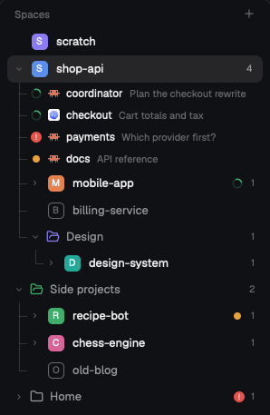

# Spaces Tree

Your [Herdr](https://herdr.dev) spaces as a folder tree, with their agents inside. Groups nest, projects you are not working on can wait as dormant entries, and agents can arrange the tree from a shell.



*The picture shows the mod's demo data (`props { demo: true }`), not a real project.*

## What it does

- **Groups you name, at any depth.** A group is a folder row (Work, Side projects, ...) with what it holds under it, joined by tree lines: its spaces, its dormant entries, then its groups. A click folds it. Spaces in no group stay at the top.
- **A space can head a branch.** Give a group a head and its row shows that space (avatar, name, state, agent count) instead of a folder: a lead space with the spaces it runs under it. A click on the row shows the space; its chevron folds the branch; the agent count opens the head's agents. When the head space closes, the row is a folder again, or, when a dormant entry backs it, that entry (a click opens it again).
- **Agents in the same tree.** A space with agents has a chevron that opens them: one row per agent with its program's logo and what it is on. A click shows that agent. It replaces the separate Agents list.
- **States as icons.** A green ring that turns: active. A red "!": needs you. An orange dot: finished and not looked at yet. A grey ring: idle. A closed space and a folded group show the loudest state of everything inside, at every level.
- **Dormant entries.** A project with no open space: a name, a folder and, if you like, the agent to start. It shows with a hollow avatar. A click opens a real space there, in the same place in the tree. When that space closes, the entry goes back to dormant instead of disappearing. Keep every project in the tree without keeping every space open.
- **Moving things:** drag a space or a folder onto a folder to put it inside; drop it on the "Spaces" title to take it out of every group. Hover a space and press **⋯** to pick a group or type a new one (`Clients/Acme` makes both). A right click on a folder renames it, moves it to the top level or deletes it (what it held goes up one level). A right click on a dormant entry opens or removes it.
- **Group colors:** a group's folder can have its own color (set it with the agent API).
- Everything else is Herdr's own spaces list: colored avatars, worktrees under their checkout, drag to reorder, the space menu on right click, machines.

## The agent API

Agents (and you) change the tree from a shell with `bin/spaces-tree`, while the app runs. Every call prints JSON and exits 0 on success, 1 when the request was refused (the reason is in `error`), and 2 when the mod did not answer (then nothing changed).

```sh
ST=~/.config/herdr-app/mods/spaces-tree/bin/spaces-tree

$ST list                     # the whole tree as JSON
$ST list --text              # the same, indented, for a quick look

$ST group add Work --color blue
$ST group add Clients --parent Work            # nested; adding one that exists returns it
$ST group add Acme --parent Work/Clients       # three levels
$ST group rename Work/Clients Customers
$ST group move Acme --parent Work              # or --top; --before GROUP sets its place
$ST group color Work '#5b8def'                 # teal orange blue purple green pink, ansi0..15, #rrggbb, none
$ST group fold Work                            # and: group unfold Work
$ST group head Work lead-space                 # the group's row shows that space (it joins the group)
$ST group head Work --dormant billing          # a dormant entry heads it; --none: a folder again
$ST group rm Work/Customers                    # what it held goes up one level

$ST space put sp3f9c... --group Work/Acme      # a space id from `herdr-app ls`, or a unique name
$ST space put shop-api --group Work --first    # or --before SPACE: its place in the group
$ST space put shop-api --none                  # out of every group

$ST dormant add billing --folder ~/code/billing --group Work --argv '["claude"]'
$ST dormant add --space shop-api               # back an open space: it sleeps here when it closes
$ST dormant open billing                       # opens the space, prints its id; --focus shows it
$ST dormant put billing --group Work/Acme      # or --none
$ST dormant rm billing                         # forgets the entry; an open space stays open
```

A group is named by its id, its path (`Work/Clients`) or a name only one group has. A dormant entry is named by its id or a name only one entry has. `--argv` takes a JSON list or a plain command line. `$ST raw '{"op":"group.add","args":{"name":"Work"}}'` sends any request as it is.

`list` answers with every group (`id`, `name`, `path`, `color`, `folded`, `head` = `{ space, name, open, dormant }` or null, and its `spaces`, `dormant` and `groups`), then `ungrouped` spaces and dormant entries. A space carries its `id`, `name`, `folder`, `machine`, `status` and, when a dormant entry backs it, that entry's id in `dormant`; a group's head is in its `spaces` too, with `head: true`. A dormant entry carries `open` and the `space` it has open now.

**How it works.** Herdr has no way to pass arguments to a mod and get an answer, so the API uses files. The script writes each request to `~/.config/herdr-app/data/spaces-tree/inbox/<id>.json` and nudges the mod (`herdr-app do spaces-tree.inbox`); the mod also watches the folder. The mod applies the change to the tree in Herdr's shared state and writes the answer to `outbox/<id>.json`, which the script prints and deletes. The tree itself is shared state, so it survives an app restart. If no answer comes in time (the mod is not in the shown layout, or the app is closed), the script takes its request back, so it does not happen later. `HERDR_APP_HOME` picks another app home, as for `herdr-app`. The script needs `python3`.

## Install

Built and tested on **Herdr app 0.1.16 with herdr-core 0.1.21**, macOS. It is a fork of the `spaces` mod of Herdr 0.1.15.

Ask your agent in Herdr:

> Add the mod herdr.dev/mods/klinter007/herdr-spaces-tree and use it in my sidebar in place of spaces and agents

Or by hand: copy the folder, then in your own layout file (`~/.config/herdr-app/layouts/<name>.json`; clone the shipped layout first with `layout.clone`) change the sidebar's `spaces` block to this mod and remove the `agents` block:

```sh
git clone https://github.com/klinter007/herdr-spaces-tree
cp -R herdr-spaces-tree/mods/spaces-tree ~/.config/herdr-app/mods/
herdr-app check ~/.config/herdr-app/mods/spaces-tree
```

```json
{ "id": "spaces", "type": "block", "content": { "mod": "spaces-tree" } }
```

## Upgrading

From 2.0: nothing to do; groups get an empty `head`.

From 0.2: the groups of version 0.2 (`spaces-tree.groups`) become top-level groups of the new tree on the first start, with the same spaces, folds and open spaces. The new tree is kept in `spaces-tree.tree`; the old key is left as it was.

## Good to know

- The mod puts your spaces in the tree's order in Herdr too, so next and previous space follow the groups.
- The tree is kept in Herdr's shared state (`spaces-tree.tree`).
- You see an agent only when its space is open in the tree; a closed space shows the count and the loudest state.
- Dormant entries show on their machine's part of the sidebar (`--machine` for one on another machine).

## License

The changes are MIT. The base is Herdr's `spaces` mod; see [LICENSE](LICENSE).
