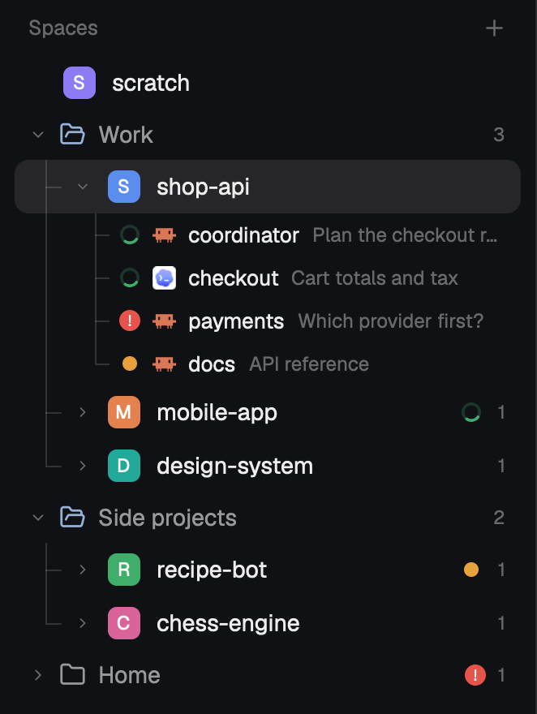

# Spaces Tree

The sidebar's spaces list as a folder tree. A person puts spaces in groups they name; each group is a folder row with its spaces under it, and each space opens to show its agents with their state.

**What you see:**

- Everything Herdr's `spaces` mod shows (this is a fork of it, 0.1.15): the "Spaces" header with +, a 30 px row per space with an 18 px colored avatar, the name, and the repo or branch at the right; machines as headers when there is more than one.
- Spaces in no group first. Then one folder row per group, 28 px: a chevron, a folder icon (open and `accent` when open, closed and `muted` when folded), the name, the number of spaces at the right. A folded folder also shows the loudest state inside it.
- A space in a group has a guide at its left: a 1 px line down from the folder and a 9 px tick to the row; the last one ends at the tick.
- Every space row starts with a 10 px chevron when it has agents. Closed: the loudest state and the number of agents at the right. Open: one 24 px row per agent under it, with its own guide, a 12 px state icon, the program's logo (13 px), the tab's name or the agent's title, and the title in `dim` after a named tab.
- States: working `#3fae6a` (the shipped spinner, turning), blocked `#e5534b` (a disc with "!"), done `#e8a23d` (a dot), idle (a ring in `dim`). Loudest first: blocked, working, done.
- Hovering a space shows "⋯" at its right.

**How it behaves:**

- A click on a folder folds or opens it. A click on a space's chevron opens or closes its agents. A click on an agent runs `agent.focus { terminal }`.
- Drag a space onto a folder: it joins that group. Drop it on another space: it goes beside it and into that space's group (or out of a group).
- "⋯" opens a popup: the groups (the current one ticked), "No group", and a field for a new group's name. A right click on a folder opens a popup to rename or delete the group; deleting leaves its spaces in no group.
- The spaces are kept in the tree's order in Herdr (`space.move`), so space.next and space.prev follow it.
- `props { demo: true }` shows made-up spaces, groups and agents and changes nothing.

**Built from:**

- `mods/spaces-tree/`: `main.js` (Herdr's `spaces` with the additions), `mod.json`, `folder.svg`, `folder-open.svg`. It uses the shipped `mods/workspace-chrome/*.svg` and opens the shipped `menu` mod for a space's menu.
- The groups: shared `spaces-tree.groups` = `{ order: [name], of: { spaceId: name }, folded: [name], open: [spaceId] }`.
- `herdr`: as `spaces`, plus `agents()`, `props`, `closeOverlay`; `gpui-base`: `InputState`, `Input` for the popups, which are this same mod opened with `openOverlay({ mod: "spaces-tree", kind: "popup", props: { pick: spaceId } | { group: name } })`.

**Watch out:**

- In the narrow rail (the sidebar under 160 px) there are no folders, only the spaces.
- The demo must never write shared state: it skips the group and color saves.
- A worktree space goes with its checkout's group.
- The shipped `spaces` mod changes with Herdr; this fork does not take those changes by itself.

**Done when:**

- `herdr-app check ~/.config/herdr-app/mods/spaces-tree` passes.
- With `props { demo: true }` it shows seven spaces: one at the top, three folders, the first space open with four agents.
- A space dragged onto a folder shows under it, and still does after a restart.
- A folded folder with a blocked agent inside shows the red "!".
